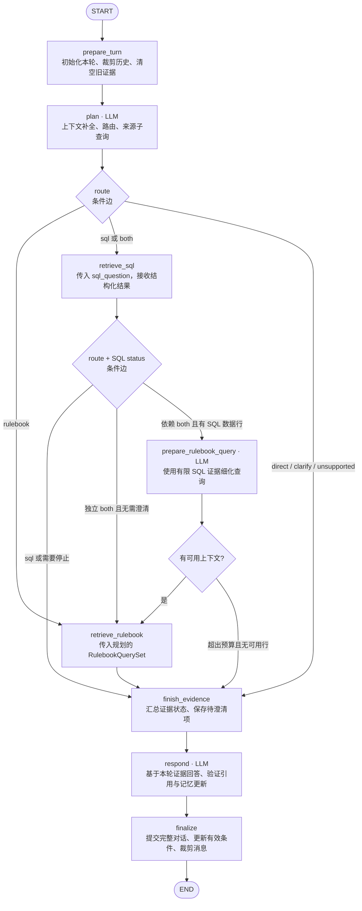
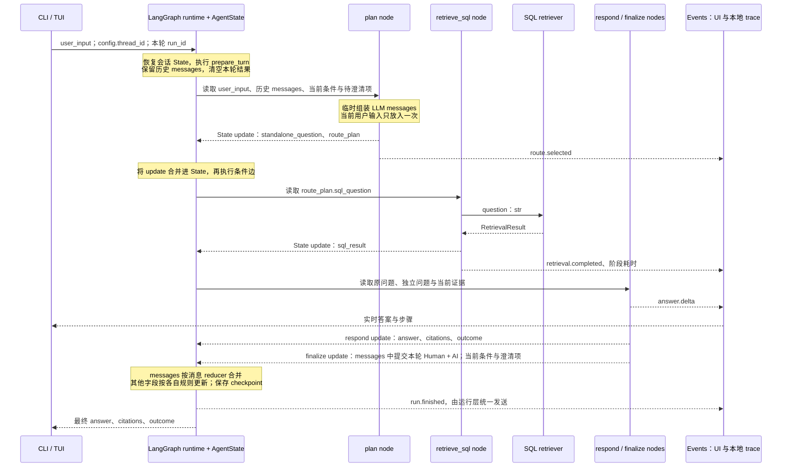

# Agentic RAG：简版设计与 Spec v0.11

状态：Draft。完整问答 graph、单次/交互 CLI、Textual TUI、统一轮次入口和本地 graph trace 已实现并有离线验证。包含会话内记忆、引用校验、澄清、节点输入/输出与耗时、LLM 调用计数与 provider usage、异常/取消终态、离线查看。完整请求预算、模型请求/响应全文留存与检索器内部 instrumentation、答案 token streaming 仍待实现。

## 1. 目标与范围

在现有 rulebook retriever 和 SQL retriever 外增加 LangGraph 编排层，完成：理解当前问题与会话上下文 → 选择数据来源 → 检索 → 基于证据回答。用户通过 CLI / TUI 使用；TUI 能实时查看执行步骤、路由、来源和耗时。

约定：

- **会话（session）**：从启动聊天到 `/new` 或退出的一段多轮对话，对应一个 LangGraph `thread_id`。
- **轮次（turn）**：一条用户输入及其处理过程；每轮生成独立的 `run_id`。
- **短期记忆**：只在当前进程、当前会话内保留。默认不承诺退出后恢复，不做跨会话长期记忆。
- **历史 trace**：每个会话、每轮执行默认保存到本地，供 evaluation / debug 使用；独立于会话记忆，不自动成为后续模型上下文。
- v1 是有界的 agent workflow：模型规划来源、根据工具结果细化后续查询、生成回答；控制流和调用次数由应用约束。

v1 不包含跨会话用户画像、Web 搜索、写数据库、通用工具插件系统、无限 ReAct 循环、独立 critic agent、向量库重建或完整对局合法性推理。

## 2. 复用现有能力

| 模块 | 当前接口 / 行为 | 外层职责 |
| --- | --- | --- |
| Rulebook | `RulebookRetriever.retrieve(RulebookQuerySet)`；Dense + BM25 + RRF + rerank；返回 `RetrievedRulebookContext` | 生成查询集，保留 chunk、规则路径和 PDF 页码 |
| SQL | `retrieve_sql(question)`；内部选择 fixed / generated，精确实体消歧，只读执行，必要时一次 SQL repair | 传入补全上下文后的独立问题，处理结构化状态 |
| LLM | 现有 Google GenAI SDK | 复用 provider；外层负责规划与最终答案 |

外层只决定“需要什么来源”；SQL 内层继续决定“怎样查询数据库”。不重复实现 SQL 函数选择、名称匹配或执行安全策略。

现有 SQL 结果状态为 `ok / empty / needs_clarification / unsupported / error`，必须保持含义。Rulebook 的空结果在适配时映射为 `empty`。

### 2.1 统一查询入口与 retriever 边界

推荐由有类型的 `AgentState` 统一承载 agent 的问题、会话上下文、路由计划与结果；保留 `RulebookQuerySet` 作为 rulebook 检索的专用输入。当前不另建覆盖所有来源的通用 Query 类，也不为只接收字符串的 SQL 入口增加空壳 Query 类。

| 层 | 信息 / 契约 | 职责 |
| --- | --- | --- |
| 应用入口 | `user_input` + 会话运行上下文 | 接收用户原话，关联 session / run |
| Graph State | messages、会话状态、独立问题、route plan、两种结果 | 在节点间保存有明确字段含义的数据 |
| Route plan | route、sql_question、rulebook_query_set、depends_on_sql、reason | 由外层完成上下文补全、来源选择与子问题规划 |
| Rulebook 输入 | 现有 `RulebookQuerySet` | semantic_query 供 dense / rerank，original_query 与 keyword_query 供对应 BM25 路径 |
| SQL 输入 | 现有 `question: str` | 一个已补全上下文、聚焦数据库事实的子问题；内部负责 fixed / generated、实体验证与 SQL 执行 |

- LangGraph 节点读取所需 State 字段并返回更新；`messages` 专门保存对话消息，不把 route、SQL、query set、timing 等内部数据塞进消息正文后再解析。
- `route_plan` 是子查询的唯一权威位置，不再同时维护另一份顶层 sql_question / rulebook_query_set。依赖 SQL 的查询细化更新该计划，并在 trace 中保存修改前后值。
- 节点内做直接的字段提取 / 类型构造即可：plan 节点验证模型输出后构造 `RulebookQuerySet`，rulebook 节点直接转交；SQL 节点将 `sql_question` 传给 `retrieve_sql`。不增加通用 adapter 类或 retriever 基类。
- 原始用户输入以 `AgentState.user_input` 为准。`RulebookQuerySet.original_query` 是调用边界派生的副本，沿用当前契约；它不承担整个会话的统一元数据职责。
- State 中的 query payload 采用具名、可序列化的字段结构；LLM 返回的规划在边界验证。`TypedDict` 的类型标注本身不提供运行时校验，内部合法数据不重复验证。
- retriever 不接收完整 AgentState、聊天历史或 LangGraph Message，不依赖 LangGraph 类型。相同接口应继续支持直接脚本调用、独立测试与离线评测。
- 输出保留各自原始结果结构；供 UI / trace 消费的 source、status、count、duration 等摘要由节点统一发布，不把 SQL rows 强制转换成规则 chunk。

这样统一的是编排层的数据契约与可观测性；规则检索和 SQL 检索继续保留各自有意义的输入。

### 2.2 Query 改写的现状与计划

Rulebook retriever 本身不执行 LLM 查询改写：`RulebookQuerySet.normalised()` 只清理空白并补齐缺省值，缺少 semantic_query / keyword_query 时分别使用原问题与单元素原问题列表。CLI 的 `--semantic-query / --keyword-query` 接收调用者手动提供的值。`agent.nodes.plan` 已实现英文语义问题与规则关键词的自动生成；`agent.graph` 已将规划接到两种检索器，依赖型 `both` 最多增加一次规则查询细化调用。

当前 SQL 同样没有自然语言问题改写步骤：传入的 question 直接用于内部 routing、实体提取，以及 generated 路径的 SQL 生成。它已经读取数据字典、匹配实体并生成查询；SQL 生成与编译错误 repair 保持现有职责。

| 转换 | 放置位置 | v1 决策 |
| --- | --- | --- |
| 指代补全、继承当前有效条件 | 外层 plan，结合 messages / conversation_context / pending_clarification | 两种来源共用；生成 standalone_question |
| 混合问题的来源子问题拆分 | 外层 plan | 生成完整覆盖相应任务的 sql_question 与规则查询，保留条件 |
| 英文规则表述与关键词抽取 | 外层 plan；必要时 prepare_rulebook_query | 服务 rulebook 的 dense / BM25；复用同一次结构化规划调用 |
| SQL 专用自然语言扩写 / 同义问题扩展 | 暂不增加 | 现有 SQL 模型直接理解完整子问题；额外改写需要先证明结果正确性收益 |
| 数据字典 grounding、实体匹配、NL-to-SQL、编译错误修复 | SQL retriever 内部 | 复用现状，外层不重复实现 |

SQL 子问题应写明从上下文补入的实体与条件，不只传“它呢？”或“第二个”。名称 / ID 保持来自用户或真实候选的原值；数字、比较符、否定、排序、数量限制、点数配置等语义不得因改写丢失。“最好 / 最便宜”等缺少定义的问题保留歧义，交由澄清流程处理，不在改写时替用户定义。

Trace 保存 `user_input → standalone_question → 实际来源子查询` 的链路，并记录 SQL 后的规则查询细化。原问题与改写结果分开保存，便于分别评测上下文补全、子问题覆盖和 SQL 结果正确性。v1 不为 SQL 额外增加独立 rewrite 模型调用。

## 3. 图与路由



图中是当前已实现的完整问答 graph；预算内无可用 SQL 行时，细化节点直接停止，不调用细化模型，再进入回答阶段说明限制。菱形表示条件边，不额外调用模型。各节点通过共享 State 读写字段，箭头不表示只把上一个节点返回的字段作为完整输入传给下一节点。`agent.runtime.run_turn` 已统一异常 / Ctrl-C 的轮次结果与 trace 终态。

完整入口为 `build_agent_graph()`；`build_evidence_graph()` 保留止于 `finish_evidence` 的检索检查入口。两者每次调用都显式提供 `context=EvidenceContext(...)`，通过 `config.configurable.thread_id` 选择会话。可用 LangGraph 原生 `stream_mode="updates"` 查看完成节点及其 State 更新；这还不是第 6 节的完整事件流。

### 3.1 State、messages 与检索 payload 的传递

以下以单 SQL 展示完整问答路径；当前已实现 State、回答提交与 graph 层生命周期事件，图中的 token 增量和检索器子阶段事件仍待接入。rulebook 路径将专属输入换成 RulebookQuerySet、结果换成 RetrievedRulebookContext，State 更新规则相同。



具体约定：

- CLI / TUI 每轮只提交当前 user_input 与运行标识；历史由 thread_id 对应的 State 恢复，不把整个聊天记录反复提交。
- State.messages 保存已提交的用户 / 助手对话。当前 user_input 在 finalize 前独立存储；plan 临时构造模型消息，不把规划 JSON 写成可见 AIMessage。
- respond 使用独立问题、必要当前条件和本轮证据构造临时模型输入，并优先按用户原始输入确定回复语言。当前方案使用显式检索节点，检索结果保存在 sql_result / rulebook_result 字段，无需伪造 ToolMessage。
- finalize 对有完整用户回复的轮次，以稳定消息 ID 一次性提交 HumanMessage 与 AIMessage，包括澄清回复和有效的 partial 回答；取消 / 生成失败的草稿仅留在 trace，不作为成功对话对提交。随后按预算更新工作消息窗口。
- 节点只返回需要修改的字段。普通字段默认覆盖，messages 使用 add_messages 按 ID 合并；嵌套 route_plan 更新时返回完整的新 plan，不假设 LangGraph 自动递归合并嵌套字典。
- 专属 query / result payload 保持结构化。将 State 转为 retriever 参数、将结果写回 State 的操作都在对应 node 内完成；retriever 不读取 messages 或完整 State。
- step、usage、answer.delta 等事件经独立事件流发给 UI 和 trace writer，不把整条事件历史追加到 State.messages 或 checkpoint。
- 客户端、retriever 实例与事件回调通过 runtime context 传入；thread_id 通过 config 关联 checkpoint。运行对象不进入 query payload。

### 路由契约

`plan` 用一次结构化模型调用，同时完成指代补全、来源选择和查询规划。

当前节点 API 为 `prepare_turn(state)` 和 `plan(state, *, client=None, model=...)`。plan 的模型响应使用内部 JSON schema，包含 `starts_new_topic`；该字段用于清理旧的会话条件和待澄清项，不加入公开 RoutePlan。原始输入由程序附到 RulebookQuerySet，模型不生成 original_query。无效 JSON / 路由组合通过 Pydantic 在模型边界拒绝，provider 错误直接抛出；运行层的错误展示与事件发送后续接入。

| route | 适用问题 | 示例 |
| --- | --- | --- |
| `rulebook` | 通用规则、术语、行动流程 | “Advance 后能射击吗？” |
| `sql` | 单位属性、点数、能力文本、数据库筛选和比较 | “Warboss 有哪些能力？” |
| `both` | 单位数据与通用规则共同决定答案 | “查出 Warboss 的能力，再解释其中涉及的核心规则。” |
| `direct` | 问候、功能说明、界面使用帮助 | “你能做什么？” |
| `clarify` | 会话指代不清或缺少必要问题条件 | 多个单位都被提及时问“它呢？” |
| `unsupported` | 现有资料与能力明确无法支持的请求 | 要求查询实时赛事结果 |

规划结果至少包含：`route`、`standalone_question`、简短 `reason`，以及所选来源需要的 `sql_question`、`rulebook_query_set`、`depends_on_sql`。澄清 / 不支持分支还包含面向用户的说明。

- 用户原始输入单独保存。`standalone_question` 补全指代，不改变条件、数值或用户意图。
- Rulebook 查询集继续使用现有 `original_query / semantic_query / keyword_query`；`original_query` 保留当前用户输入，`semantic_query` 是补全上下文后的英文规则问题，`keyword_query` 是 3–8 个英文规则术语。
- SQL 接收独立的子问题。历史中用户明确提供的名称 / ID，以及数据库返回的候选选项，可以显式补入子问题；不发明、翻译或模糊替换实体名 / ID，后续仍由 SQL retriever 验证。
- `both` 默认串行 SQL → rulebook。若规则查询依赖 SQL 查出的能力名或关键词，`prepare_rulebook_query` 最多再调用一次模型，用有限 SQL 证据细化查询集；独立问题直接使用已规划的查询集。
- `both` 中 SQL 需要澄清时先询问用户，暂停依赖它的规则检索。SQL 失败 / 无结果时，只继续不依赖 SQL 的规则子问题，并明确缺失部分。
- 明确切换话题时不沿用旧单位或旧筛选条件；仍有多个合理指代时走澄清。
- `direct` 不产生新的规则或数据库事实；新的领域事实应重新检索。

**执行预算**：每轮至多调用 SQL retriever 一次、rulebook retriever 一次；无外层自动重试或反复重规划。SQL 内部现有的一次编译错误修复保留。常规外层为“规划 + 回答”两次模型调用；SQL 依赖的规则查询最多增加一次，SQL 自身模型调用另计。

路由字段、模型结构化输出在边界验证；不为内部确定性数据重复添加检查。无效规划返回可观测的错误，不默认为查询所有来源。不把模型自报的 confidence 当成概率或验收指标。

## 4. State 与短期记忆

使用一个 `StateGraph` 和进程内 `InMemorySaver`。同一会话重复使用 `thread_id`；新会话生成新 ID。同一会话一次只运行一轮。

| 生命周期 | 字段 | 说明 |
| --- | --- | --- |
| 会话级 | `messages` | 用户与完成的助手消息，使用消息 reducer；重试 / 再次调用不重复提交历史 |
| 会话级 | `conversation_context` | 当前实体 / 话题、用户明确的筛选条件和规则版本等，附来源轮次；只保存当前有效的信息 |
| 会话级 | `pending_clarification` | 原始待解决问题、缺失条件、SQL 候选项、原轮次 ID |
| 本轮级 | `run_id / turn_index / user_input` | 当前轮次身份 |
| 本轮级 | `standalone_question / route_plan` | 补全后的问题与规划 |
| 本轮级 | `rulebook_result / sql_result` | 两种原始结果，保持各自结构 |
| 本轮级 | `evidence_status / retrieval_errors / sql_context_truncated` | 证据阶段结果、规则来源可用性错误，以及 SQL 细化上下文裁剪标记 |
| 本轮级 | `answer_context_truncated / context_updates` | 回答时按来源记录裁剪；经验证、等待 finalize 合并的会话槽位更新 |
| 本轮级 | `answer / citations / outcome` | 当前轮次输出 |
| 运行时 | retriever、LLM client、取消标记、事件发送器 | 通过运行上下文传入，不保存到 checkpoint |

当前 `EvidenceContext` 只包含模型 client / model 与两个检索器依赖；取消和事件回调后续接入。checkpoint 使用显式允许的四种既有 dataclass，读回时恢复 SQL rows、规则结果与关键词的 tuple 字段；不采用 pickle 回退。完整 graph 的 finalize 已提交 Human/AI 对话并更新已验证来源的会话槽位，支持同一 thread 内的普通追问和待澄清项延续。

`evidence_status` 的 `ok / empty / partial / needs_clarification / unsupported / error / skipped` 仅描述证据可用性；`ok` 不保证规划正确或证据相关。完整 graph 由 respond 写入 `answer / citations / outcome`，证据版入口仍保持答案未设置。模型输出非法或 provider 异常直接抛出，保留最后成功 checkpoint，不执行失败后的 finalize。规则索引 / 模型的预期可用性错误记入 `retrieval_errors`；SQL 保留自己的 `error_code / message`。

respond 在同一次结构化输出中提出最多 8 个记忆更新，限定为单位 / 阵营 / 分遣队名称和 ID、topic、conditions。用户来源必须逐字出现在本轮原话中；SQL 来源只能来自未截断结果中受识别实体列的唯一值，不能取统计值或多实体列表中的任意一行。finalize 给值附上当前来源 run ID；名称或 ID 改变而另一项未更新时，删除旧的配对项。slot 来源可验证，slot 选择的语义和复合筛选条件覆盖仍需真实模型评测；不增加独立记忆抽取或摘要调用。

行为要求：

1. `prepare_turn` 每次覆盖全部本轮字段，防止上一轮证据、路由、错误或耗时混入新问题。
2. `pending_clarification` 跨轮保留。用户回答“第二个”时，从上次真实候选项取名称 / ID，重建原问题并正常重新检索；不把“第二个”单独交给 SQL。
3. 用户换话题时清除待澄清问题；取消的轮次不留下新的待澄清项。
4. 提示词默认最多取最近 8 个完成轮次；原文窗口同时受 5,000-token 预算约束，以先达到的上限为准。超出时按完整旧轮次裁剪，保持用户 / 助手消息配对，并在 metadata 中报告裁剪。
5. 历史消息帮助理解问题，当前证据负责支持答案。数据库结果和规则 chunk 不作为永久对话消息反复注入。
6. v1 先采用裁剪与结构化状态，不增加 LLM 自动摘要调用。裁剪后仍可从当前结构化状态补全指代；无法确定时请用户补充，不从磁盘 trace 自动检索旧对话。

### 4.1 Token 预算

下列数值是应用的起始默认值，需通过真实问题评测调整，不是模型官方窗口上限，也不是每次都要填满的配额。预算按每次模型请求计算，不把一轮中多次调用的 token 相加后作为上下文长度。

实现进度：当前 prepare_turn 使用现成的消息裁剪工具，保留最多 8 个完整轮次、约 5,000 tokens，并以 Overwrite 更新 State.messages。Gemini 精确计数、结构化上下文预算和完整的 24,000-token 请求上限尚待后续预算集成，不能把当前估算称为精确硬上限。

| 输入组成 | 默认预算 | 说明 |
| --- | --- | --- |
| 最近对话原文 | 5,000 tokens，且最多 8 个完成轮次 | 从新到旧保留完整轮次 |
| 当前结构化状态 / 澄清上下文 | 1,000 tokens | 与最近原文合计最多 6,000 tokens |
| 当前用户问题 / 子问题 | 2,000 tokens | 超出时提示缩短或限定范围，不静默截断关键条件 |
| 当轮检索证据 | 10,000 tokens | rulebook 与 SQL 合计；继续受 top-k、行数和字节上限约束 |
| 指令、完整 SQL 字典、schema、序列化开销与余量 | 6,000 tokens | 缓存固定内容的计数；SQL 字典不能因超预算任意截掉 |
| **单次模型输入总上限** | **24,000 tokens** | 各节点只接收所需内容；上述局部配额可以在总额内调配 |

最终答案默认最多 2,000 output tokens；结构化路由、SQL 生成使用各自更小且足以容纳结果的输出限额。输出 / thinking 预算另按实际 provider 规则预留，不能拿输入预算替代。

- 每次发送前计算完整请求大小，包含 system、消息、字典、schema 和证据；使用实际模型的 token 计数方式，不能用字符数或 BGE tokenizer 代表 Gemini 的 token 数。
- 固定输入计数可缓存；完整组装后使用 provider 计数能力确认预算，并分别记录本地估计、请求前计数和响应 usage。计数请求本身的耗时也进入 trace。
- 实际可用输入上限取应用上限与模型限制的较小值；对输入 / 输出共享窗口的模型，还要扣除输出 / thinking 预留和余量。模型限制通过配置或模型元数据确认，不硬编码某个系列的最大窗口。
- 总额不足时先移除较旧完整对话，再减少低优先级证据；证据按完整 chunk / 行处理并标注裁剪。不删除当前问题、关键筛选条件或仍在使用的引用正文来伪装成成功适配。
- 不可裁剪的最小输入仍超额时，明确报告 context budget exceeded，并请用户缩小范围；不自动放大预算或删除 SQL 字典。该检查也覆盖 SQL 内部 routing / generation / repair 调用，不能只限制外层回答节点。
- `conversation_context` 只复制用户明确提供或工具实际验证的值，保存来源轮次。实体 ID、数值、否定条件原样保留；新问题中的显式条件优先，切换话题时清掉过期条件，不把模型旧答案当成事实槽位。
- `pending_clarification` 的完整候选映射可保存在轮次详情中，给模型的表示受上述预算限制；“第二个”由真实候选顺序解析。候选过多时请求进一步限定范围，不能任意挑选。

### 4.2 是否做摘要压缩

v1 默认不做 LLM 摘要，避免为短问答增加模型调用和摘要漂移；先评测最近窗口与结构化状态是否满足追问需求。LangGraph 提供消息裁剪 / 删除与摘要模式，但 checkpointer 本身不会自动压缩会话。

如果长会话评测显示“早期约定被裁掉”是实际问题，再增加有界 rolling summary：

- 仅在原文即将移出窗口时压缩旧轮次，结合旧摘要更新；保留最近原文，不在每轮都摘要。
- 摘要最多 1,000 tokens，从现有 6,000-token 会话预算中划出：最近原文 4,000 + 摘要 1,000 + 结构化状态 1,000，总预算不增加。
- 摘要保留用户目标、尚有效的约束、未解决问题及来源轮次；单位名 / ID、数值、否定条件与待澄清候选由结构化状态保留，不靠自由文本摘要重写。
- 规则结论、SQL rows 和规则 chunk 不压成永久事实记忆；回答新领域问题仍依赖当前检索证据。
- 每轮最多一次摘要调用，单独计入调用次数与耗时；记录压缩输入、前后摘要、覆盖轮次和 token 变化。摘要是会话辅助信息，不能提升为系统指令或事实证据。
- 摘要失败或仍超预算时采用已有窗口裁剪，明确记录丢失的上下文；不阻塞后续问答，也不声称保留了全部历史。

### 4.3 模型上下文、State 与 checkpoint

完整原始历史由 trace 保存。工作 State 的 `messages` 也应在轮次边界按上述窗口更新，不能仅裁剪传给模型的副本、让 State 中的列表无限追加。

State 窗口变小并不会删除 `InMemorySaver` 已保存的旧 checkpoint。v1 不需要跨历史 checkpoint 的 time travel，可在每 32 个已完成轮次后、无活动调用时做一次 checkpoint 轮换：保存精简的会话 State 作为 seed，清理该 thread 的旧 checkpoint，下一轮以同一会话 ID 和 seed 启动。操作不删 trace、不改消息来源 ID，且不在活动轮次中进行。

实现进度：当前已接入 InMemorySaver、结果类型回读和 CLI `/new` 删除旧 thread checkpoint；上述定期轮换尚未实现，不能将当前消息窗口上限理解为全部 checkpoint 的内存上限。

`/new` 清理旧会话的 checkpoint、seed 和内存详情缓存，保留已落盘 trace；TUI 的旧轮次正文从 trace 按需读取，避免再次在内存保存全量副本。需要跨进程恢复聊天时，再引入持久化 checkpointer。上述预算限制文本工作集，不代表 embedding 模型、向量库等进程总内存的上限。

## 5. 回答、来源与结束状态

最终回答使用当前轮次检索证据，优先使用用户输入语言，并保留英文规则 / 单位名称。将检索文本作为资料处理，不能用其中的指令改变应用控制流。

| 来源 | 可展示的引用 |
| --- | --- |
| Rulebook | `[R1]` → source、`chunk_id`、`section_path`、`pdf_page_numbers`；明确为 PDF 页码 |
| SQL | `[S1]` → query ID、fixed / generated、SQL、参数、列名 / 返回行及截断标记 |

- 规则性结论引用规则证据，单位数值 / 能力事实引用 SQL 证据；同一结论需要两个来源时同时引用。
- 引用 ID 必须对应本轮真实证据；可自动验证 ID 存在性，语义是否受证据支持通过验收样例检查。
- SQL 默认最多 200 行；答案上下文另设行数 / 字节预算，v1 默认最多 50 行且不超过 32 KiB，metadata 显示实际使用量。检索器截断和答案上下文裁剪分别标记，不能据部分结果声称完整排名、全量统计或“不存在”。
- 当前依赖查询细化已执行相同的 50 行 / 32 KiB SQL JSON 预算，只移除完整末尾行，保留原始结果。`sql_context_truncated` 与 `sql_result.truncated` 分开；裁剪后无可用行时跳过规则检索并记录 `sql_context_budget`。此预算不包括完整请求的其他组成。
- 回答已复用上述 SQL 预算；规则证据另限最多 5 个完整 chunk、序列化后 32 KiB，按完整末尾 chunk 裁剪。`answer_context_truncated` 分别记录两种来源，原始结果不变；被裁掉的来源或 chunk 不分配回答引用 ID。这些是局部预算，尚未落实完整请求的精确 token 计数。
- Rulebook 沿用当前 final top 5；分数只作诊断，不设未经评估的“事实可信度”阈值。
- 资料版本冲突时展示来源及冲突；版本信息缺失时明确说明，不能声称已反映最新勘误。

轮次 `outcome`：`completed / partial / needs_clarification / unsupported / error / cancelled`。

- `empty` 表示这次查询没有匹配证据，不等于相关规则 / 单位不存在；不会触发自动放宽查询。
- 单一来源失败且没有可回答部分时为 `error`；混合问题能回答独立部分时为 `partial`，说明尚未完成的部分。
- 澄清返回问题与候选项；不进入正常事实回答。无法解决的问题保留 `pending_clarification`。
- 流式文字在 `run.finished` 前属于草稿；生成失败或取消时标记未完成，不保存为成功的助手答案。

当前回答实现：`respond(state, *, client=None, model=...)` 使用一次结构化 GenAI 调用，生成 `answer / insufficient_evidence / memory`；不接收历史答案作为事实证据。澄清、direct、不支持和无结果说明也通过这次调用按用户语言表述。SQL 候选由程序按原顺序追加带编号的完整候选字典，模型不重排、不替用户选择。

引用映射由程序建立：规则 ID 指向真实 chunk_id，`S1` 指向 `<run_id>:sql`，可通过本轮 sql_result 解析执行 SQL、参数与结果。模型只在正文引用这些 ID；未知 ID 或没有引用且未声明证据不足的事实回答在边界拒绝，无重试。程序只验证引用存在性和来源类型覆盖；具体结论是否受引用支持、输出语言和候选问题的表述需要模型评测。

outcome 由程序决定：证据 `empty` 映射 `partial`，`skipped` 映射 `completed`，澄清 / 不支持 / 来源错误保持对应状态。证据部分成功、回答上下文裁剪、模型声明不足或未引用所有请求来源类型时，不能升级为 `completed`。finalize 用稳定 `<run_id>:user / assistant` 消息 ID 合并成功、partial、澄清和不支持回复，并立即应用原文窗口预算；重复提交不重复增加消息。error / cancelled 和缺失的回复不提交。直接调用 graph 时生成/验证失败会抛异常；run_turn 已转换为 error/cancelled 结果与一次 run.finished，保留最后 checkpoint，返回副本清空未完成答案与引用。同步调用可能在 Ctrl-C 后等待返回；token streaming 后续实现。

## 6. 事件与可观测性

当前实现范围：`agent/runtime.py` 消费原生 tasks + custom 事件，CLI / TUI 和文件 writer 接收同一份脱敏事件。记录节点完整 State 输入、更新、路由/依赖细化、原始检索结果与引用、单调时钟耗时、异常类型、校验位置和无局部变量的 stack 位置；LLM 调用记录用途、model、调用标识、耗时和 provider usage，覆盖 SQL 路由、生成与 repair。节点输入不是实际模型请求；完整模型请求/响应、修复前后 SQL 快照和规则召回/融合中间排名仍未接入，下面相关条目为目标契约，不能把未记录解释为没有发生。节点耗时是观测到的生命周期耗时，包含消费流和 trace/显示开销。


CLI / TUI 与本地 trace writer 共用一条结构化事件流，UI 不解析 stderr、不依赖 retriever 私有对象。事件逐步落盘，不依赖 UI 是否展开 Inspector。

统一事件字段：`schema_version`、`session_id`、`run_id`、轮内递增 `seq`、`timestamp`、`event`、`node`、`span_id`、`parent_span_id`、`payload`。阶段完成事件包含 `duration_ms`；通过 span 父子关系区分 SQL routing、entity lookup、generation、execution、repair 等子步骤。

| 事件 | 主要信息 |
| --- | --- |
| `run.started` | turn、模型、输入和会话上下文统计 |
| `step.started / step.finished / step.failed` | 阶段名、状态、耗时、结果计数或错误码 |
| `route.selected` | route、简短理由、独立问题、两个子查询、依赖关系 |
| `retrieval.completed` | 来源、status、SQL strategy、chunk / row 数、truncated |
| `llm.started / llm.finished / llm.failed` | 已实现 call_id、用途、provider/model、响应标识/版本（可得时）、耗时、usage 和脱敏错误类型；完整请求参数与原始响应文本后续接入 |
| `answer.delta` | 最终回答的增量文本 |
| `run.finished` | outcome、引用、耗时汇总和 usage |

正常受控执行中，每个已开始轮次恰好一个 `run.finished`，覆盖成功、澄清、错误和取消。进程崩溃时可能缺少终态，离线读取时标为 `interrupted`，不补造成功事件。事件顺序由运行层统一编号；UI 按 `run_id` 区分轮次。

必须展示的 metadata：

- session ID、run ID、turn index、当前阶段、route 与 SQL strategy。
- 使用的历史轮次、原文 / 结构化状态 / 证据各自的 token 计数、单次请求上限、是否裁剪、是否存在待澄清问题；启用摘要后还显示 summary tokens、覆盖轮次和压缩次数。
- 来源数、chunk / row 数、SQL 与上下文各自的截断状态。
- `route_ms / rulebook_ms / sql_ms / answer_ms / total_ms`；阶段细分按可获取的信息显示。`total_ms` 覆盖整个轮次，包含依赖查询细化等额外工作，不要求等于这四项之和。
- `first_answer_token_ms` 从收到用户输入计到首个答案 token；不是首个步骤事件。采用 monotonic clock 计算耗时，墙上时间用于事件时间戳。
- LLM SDK 调用次数（失败也计入），以及 provider 返回的 nullable token 用量；API 报错/缺失 usage 为 null，不记为 0；旧 trace 显示 unavailable。已知小计与覆盖率独立展示，不用本地估计替代。
- 首轮模型加载时间纳入本轮耗时，并在有阶段事件时标出；不混淆冷启动和后续查询。

接入方式：

- 用 LangGraph 原生 streaming 发出节点进度，以 custom 事件承载应用事件；继续使用 Google GenAI SDK 的流式输出转发 `answer.delta`，无需仅为 token 流额外更换模型 SDK。
- 当前 SQL `_timed_phase` 只打印 stderr。增加一个可选事件回调，沿现有阶段发送开始 / 结束及必要的模型 usage、strategy；关闭 TUI 路径的 stderr timing，不解析打印文本。
- Rulebook 同样增加可选事件回调，覆盖 dense、两路 BM25、fusion、rerank。已有调用方式和返回值保持兼容。
- UI 展示简短的路由依据与真实执行记录；细节中可展开实际查询、SQL 和证据。API key 与 provider 原始异常不进入事件。

### 6.1 本地 trace 留存

已实现下述目录与默认留存、逐行 flush、写盘失败提示、进程退出后只读查看、尾行残缺及 interrupted 判断。session.json 包含 Python/LangGraph、初始模型、uv.lock 与工作源码指纹；源码快照、数据版本和完整历史环境尚未保留，指纹不能单独重现旧环境。当前不记录 provider 原始异常消息，保留类型、校验位置和 stack 文件/函数/行号；配置中可获取的 key 与认证字段会脱敏。

v1 使用标准库 JSON / 文件 IO，每个会话一个目录、每轮一个追加写入的 JSONL 文件：

```text
data/traces/<session_id>/
  session.json          # 创建时间、应用 / 数据 / 配置版本
  <run_id>.jsonl        # 按 seq 排序的事件与输入 / 输出
```

- 默认保留全部会话和轮次，包括错误、澄清和取消；`/new` 与退出不删除 trace。提供 `--no-trace` 显式关闭本地留存；`--trace` 只控制 CLI 是否展示步骤。
- 每个重要事件写完整一行并 flush；正常退出关闭文件。进程崩溃后仍能读取完整行，尾部不完整行报告后跳过。v1 不承诺断电后的逐事件持久性，不逐 token 执行磁盘同步。
- `answer.delta` 保持实时传给 UI；磁盘端可按小批聚合，终态前刷新缓冲，并保存最终完整答案，避免每个 token 一次写盘。
- 写盘失败时 UI 明确标记 trace 不完整；保留可用的交互结果，不把留存失败伪装成留存成功。失败信息不依赖同一已失效的 writer 才能展示。
- trace 默认仅存本地；实现时将 `data/traces/` 加入 `.gitignore`。不保存 API key、请求认证头或完整 SDK client 对象；应用异常保留脱敏后的类型、消息与 stack trace。
- v1 不自动按时间删除；需要清理时显式执行。大规模检索 / 聚合 trace 的需求出现后，再增加 SQLite 索引。

每轮至少保留以下调试信息；大段固定输入可以引用按内容哈希保存的本地不可变副本，但不能只记录之后无法还原的哈希：

| 环节 | 留存内容 | 可定位的问题 |
| --- | --- | --- |
| 输入与记忆 | 原始问题、实际使用的历史消息、结构化会话状态、待澄清上下文、裁剪前后计数；如启用摘要，保存压缩输入 / 输出与覆盖轮次 | 指代补全错误、历史污染、上下文被裁掉或压缩失真 |
| 模型调用 | 每次调用实际发送的 system / user 内容与 schema、provider / model、可获取的模型版本、生成参数、返回文本、结构化解析结果 | 提示词问题、模型输出格式错误、错误参数 |
| Router | 独立问题、route、理由、两个子查询和依赖关系 | 选错来源、子问题遗漏或改写失真 |
| Rulebook | 实际查询集；dense / 两路 BM25 候选 ID 与排名；fusion / rerank 顺序和可用分数；rerank 候选与最终证据正文、页码 | 首阶段没召回、融合丢失、重排丢失、取对证据但回答错误 |
| SQL | fixed / generated、实体 lookup 输入与返回候选 / 选择、每次 SQL / 参数、执行状态、有限结果行、truncated、修复前后 SQL 与诊断 | 消歧错误、SQL 语义错误、执行失败、错误修复 |
| 回答 | 实际传给回答模型的证据、上下文裁剪、完整答案 / 未完成草稿、引用映射 | 证据被截掉、引用错误、答案未遵循证据 |
| 运行环境 | 代码 commit + dirty 状态 / 可获取的本地变更标识、`uv.lock` 哈希、prompt 版本、检索参数、embedding / reranker 版本、chunk / index / SQLite 数据版本或指纹 | 代码、提示词、模型、数据变化导致的回归 |
| 结果 | outcome、错误 span、脱敏异常、耗时、usage | 性能瓶颈、失败位置与成本变化 |

固定数据字典也属于实际模型输入；保存其确切版本。快照中缺失的字段标记 unavailable，裁剪的数据标记 truncated；不要把“没有记录”解释成“没有结果”。不记录隐藏推理内容，只记录可观测的输入、输出、简短决策依据和工具执行。

### 6.2 离线 debug 与 evaluation

- 提供离线 trace 查看入口，按 session / run 展示原执行树；TUI 复用 Inspector，CLI 可输出阶段摘要。只读查看不调用模型、不重新执行 SQL。
- trace 复盘重现的是“当时发生了什么”。重新运行实验需要保留对应版本的代码、配置与数据 / 索引；trace 中的局部证据快照不能替代整个检索语料。外部模型重新调用也不保证相同输出。
- 支持把选中轮次导出为 evaluation 样本，带 `source_session_id / source_run_id`、原问题及必要历史；人工补充 expected route、相关 chunk、SQL 预期结果或答案评分准则。历史成功回答不自动作为 ground truth。
- 多轮样本保留上下文和待澄清状态；数据集划分按会话分组，避免同一段对话同时进入调参与测试集。
- 先分别评估路由正确率、标注证据的 recall@k、SQL 结果正确性、答案证据支持与引用正确性；性能按 route 和冷 / 热启动分组统计，并报告样本量。修复后用相同样本对比新旧版本。
- v1 支持整轮重新运行和基于已保存证据的答案生成评测；任意节点恢复执行放到后续持久化 checkpoint 需求中。

### 6.3 LLM 调用与 Token Usage（已实现）

- `llm/instrumentation.py` 统一包裹 `generate_content`，保留 SDK 响应；规划、回答、依赖查询细化、SQL route/generate/repair 和旧 fixed-function 入口复用它，不增加重试。每次实际进入 SDK 计一次，包括 API 异常；SDK 内部 HTTP 重试、embedding/rerank 与 evaluation judge 不混入调用数。
- 事件以 call_id 为 span，parent 指向所属 graph node。节点线程通过 custom writer 通知运行层，并将事件留在本轮线程安全队列；运行层统一编号、脱敏、写盘。取消关闭 stream 后仍收取队列中的终态 usage，收到 provider 响应时先记录 usage，再进行 JSON/引用校验；取消后的回答可以丢弃，已返回的 usage 仍保留。
- 调用级 `usage` 为 provider 的六个 nullable 字段：prompt / candidates / thoughts / cached_content / tool_use_prompt / total 的 `*_token_count`。API 响应错误或完全没有 usage 时整个调用 usage 为 null；单字段缺失也保留 null，只有 provider 明确返回的 0 才记录为 0。cached 已含在 prompt 中，不重复加；total 直接使用 provider 返回值。
- `run.finished` 和 runner 返回值包含 `llm_calls` 与 usage 汇总。某字段只有在所有已观测调用都报告且 instrumentation 覆盖完整时才给出总量，否则为 null。`known_totals` 保存已知小计，`reported_calls` 保存逐字段覆盖数，`total_calls` 为已观测调用数。`complete` 要求 prompt/candidates/total 都完整；可选 thinking/cache/tool 字段仍可为 null。
- 执行 question-only 自定义 SQL callable 时标记 `instrumentation_complete=false`，避免把不透明依赖外的已知消耗当成整轮总量。调用次数与 usage 属于运行 metadata，不进入 `AgentState`、checkpoints 或下轮 prompt。
- CLI / TUI 展示轮次与会话汇总，按唯一 run_id 累计；选中历史轮次不重复相加，`/new` 清零。关闭文件 trace 仍有实时统计；旧 trace 不根据节点数估算 usage。evaluation adapter 透传同一汇总。保留 null 的统计不得在显示或 evaluation 中转成 0。

### 6.3 与 LangGraph / LangSmith 的关系

LangGraph checkpointer 保存图状态，主要服务会话延续与执行恢复；trace 记录细粒度执行事实。仅保存 checkpoint 不能替代各路检索排名、模型原始输出和 SQL repair 过程的 instrumentation。

v1 默认本地文件留存；需要现成的执行树、团队协作和线上评测界面时，可选接入 LangSmith。它支持自定义函数追踪，但当前 Google GenAI SDK 调用及检索内部阶段仍需明确接入，不能假设打开 graph tracing 就能记录所有内部请求。在线服务配置与上传单独启用，不影响本地 trace 契约。

## 7. CLI / TUI

CLI 和 Textual TUI 已实现。入口示例：

```bash
uv run python -m ui.tui
uv run python -m ui.tui --inspect data/traces/SESSION/RUN.jsonl
uv run python -m ui.cli --trace
uv run python -m ui.cli "Which abilities does Warboss have?" --trace --sources
uv run python -m ui.cli --inspect data/traces/SESSION/RUN.jsonl --sources
uv run python -m ui.cli --inspect data/traces/SESSION/RUN.jsonl --json
```

CLI 支持 `/new`、`/sources [ID]`、`/trace`、`/quit`；答案/来源写 stdout，运行 metadata/步骤/告警写 stderr。`--trace` 只控制实时步骤显示，默认仍留存；`--no-trace` 关闭文件；`--trace-dir` 可选目录。单次错误/取消退出码为 1/130，其余为 0。`--inspect` 不创建 graph、不调用模型或 SQL，只读现有文件。当前显示完整回答，无 token 增量。

CLI 使用标准库 `argparse`，TUI 使用 Textual；两者调用同一 `run_turn` 和事件转换逻辑。同步检索与模型加载在后台 worker 执行，通过线程安全消息把事件交回 UI；同一应用 v1 只允许一个活动轮次。

```text
┌ Chat ──────────────────────────┬ Inspector ────────────────────────┐
│ User: ...                      │ session / run / turn               │
│ Assistant: ... [R1] [S1]        │ route: both   SQL: fixed           │
│                                │ route / SQL / rulebook / answer ms │
│                                ├ Steps ────────────────────────────┤
│                                │ ✓ plan           320 ms            │
│                                │ ✓ retrieve_sql   710 ms            │
│                                │ … rerank                           │
├ Input ─────────────────────────┴────────────────────────────────────┤
│ > ...                  /new /trace /sources /quit                  │
└────────────────────────────────────────────────────────────────────┘
```

以上数字仅为界面示意，不是性能承诺。

- 左侧聊天在完成时显示整段回答；右侧查看选中轮次的 metadata、步骤、查询与来源。小于 100 列时，Ctrl+T 在聊天与 Inspector 之间切换。当前没有答案 token streaming。
- `/new` 开始空会话；`/trace` 展开轮次步骤；`/sources` 查看引用详情；`/quit` 退出。
- CLI 支持单次提问和交互会话；`--trace` 展示相同事件的简洁文本，单次提问也能查看来源。
- 运行中输入框不提交新问题。取消采用协作式停止：显示 cancelling，停止后续步骤与答案追加；同步在途调用可能需要返回后才能结束，结束前不启动新轮次，也不允许旧事件写入新轮次。
- 已实现 Esc 取消、Ctrl+Q 等待停止后退出；`finalize` 开始后作为原子提交完成，晚到的取消不将已提交轮次标为取消。New 与轮次选择同样在运行期间禁用。
- Enter 选中步骤查看输入/输出；Sources 展示被引用 SQL/参数/原始行与规则正文/页码/分数。完整事件只保留当前选中轮次，历史从 trace 按需读取；聊天显示缓冲最多 1,000 行，`--no-trace` 时仅当前轮次可检查。离线 `--inspect` 不创建 graph/client，不执行 SQL。
- 常规终端宽度下，耗时、路由和最终回答始终可见；详细 SQL / chunk 正文按需展开。

依赖通过 `uv` 管理。已添加 `langgraph`、`textual`；checkpoint 使用对应进程内实现，不引入服务端部署依赖。当前 Python 3.14 环境运行离线测试，解析版本保存在 `uv.lock`。

## 8. Spec 驱动的实现与验收

按可独立验收的顺序推进，每一步先确定下列契约样例和预期，再实现：

| 阶段 | 交付 | 验收重点 |
| --- | --- | --- |
| P1 | State、route schema、核心 graph、两种检索器接入、CLI | 单来源 / 双来源问答、来源引用、状态传播 |
| P2 | checkpoint、追问 / 澄清上下文、结构化会话状态、token 预算 | 指代补全、候选选择、切换会话、预算裁剪、checkpoint 轮换、旧状态清空 |
| P3 | 事件流、阶段回调、本地 trace 留存 / 离线读取、答案 streaming | 实时进度、退出后可复盘、崩溃残留、耗时边界、usage 缺失、失败 / 取消终态 |
| P4 | Textual TUI | 聊天、Inspector、轮次选择与 CLI 行为一致 |

建议起步只增加 `agent/graph.py`、`agent/events.py`、`ui/cli.py`、`ui/tui.py` 与必要包文件；状态和简单适配先就近放置，体量增长后再拆分。

最小行为验收集：

| ID | 场景 | 预期 |
| --- | --- | --- |
| A1 | 通用 Advance 规则 | 仅 rulebook；回答带真实 PDF 引用 |
| A2 | 单位属性 / 能力 | 仅 SQL；展示实际 fixed / generated 路径与 SQL 来源 |
| A3 | 单位能力结合核心规则解释 | `both`；SQL 在前，依赖查询使用真实返回的术语，结论引用两种来源 |
| A4 | 上轮询问 Warboss，下一轮问“它的 Toughness 呢？” | 补成独立问题；不丢单位、不捏造 ID |
| A5 | SQL 返回两个实体候选，用户回答“第二个” | 重建原问题并验证候选；候选上下文跨轮保留 |
| A6 | `/new` 后问“它呢？” | 不继承旧会话实体，要求澄清 |
| A7 | 从单位 A 切换单位 B；或上一轮 both、下一轮 rulebook | 不沿用 A 或旧 SQL 证据 / 状态 |
| A8 | SQL empty、error 或 rulebook 无证据 | 不编造，不放宽查询；错误与空结果区分 |
| A9 | 混合问题某来源失败 / 截断 | 独立部分可回答；标明缺失 / 不完整，不声称全量结论 |
| A10 | 非法 route JSON 或错误引用 ID | 显式结束为错误，不执行未声明来源、不输出虚假来源为有效答案 |
| A11 | 流式生成中失败或取消 | UI 保持响应，草稿标记未完成；恰好一次终态，无旧轮次事件污染 |
| A12 | 首轮冷启动、usage 缺失、历史裁剪 | metadata 如实显示；非负阶段耗时，缺失 usage 不记为 0 |
| A13 | 多轮对话后退出或 `/new`，离线打开 trace | 原会话各轮仍可读；实际上下文、查询、证据和模型输入 / 输出可关联；不调用外部模型 |
| A14 | 进程崩溃、尾行不完整或 trace 写盘失败 | 完整事件可读；标记 interrupted / 不完整，UI 报告留存失败 |
| A15 | 从含追问的 trace 导出评测样本 | 保留必要上下文与来源 run ID；人工标注预期，不把旧答案当作事实标准 |
| A16 | 超过 8 轮或 5,000-token 原文预算后继续追问 | 整轮裁剪；当前显式实体、筛选条件和待澄清状态仍有效；失去依据的指代要求补充 |
| A17 | 长证据、完整字典和长问题叠加，或 provider 窗口小于应用预算 | 每次实际模型请求均满足预算，包含 SQL 内部调用；裁剪可见，必要最小输入超额时明确报告 |
| A18 | 32 个完成轮次后 checkpoint 轮换 | 会话 seed 连续、消息不重复、追问与澄清可继续、历史 trace 完整 |
| A19 | 同一独立问题经 graph 或直接调用 retriever | node 只映射专属输入，不泄漏历史 / graph 类型；原始结果结构保持兼容，子查询修改可追踪 |

自动化测试使用 mock LLM / fake retriever 和临时 SQLite，不调用外部模型或下载 ML 模型；沿用项目 `unittest`。真实路由与答案质量另用约 20 条人工标注问题评测，分别检查来源选择、事实正确性、引用与追问处理，不比较 SQL 字符串。

实现验收命令沿用 `uv run python -m unittest discover -s tests -v` 和 `uv lock --check`；性能先记录参考机器上的冷启动、热查询与各路由延迟，再决定目标，不预设脱离现有模型与硬件的秒数指标。

## 9. 依据

- [LangGraph Memory](https://docs.langchain.com/oss/python/langgraph/add-memory)：会话级 state、checkpointer 与 `thread_id`。本文选择进程内存储以满足本地临时会话的范围。
- [LangGraph Graph API](https://docs.langchain.com/oss/python/langgraph/graph-api)：有类型的 State、节点状态更新，以及独立于 messages 字段的业务数据。
- [Gemini Token Counting](https://ai.google.dev/gemini-api/docs/tokens)：请求前 token 计数、响应 usage 与模型上下文限制的查询方式。
- [LangGraph Streaming](https://docs.langchain.com/oss/python/langgraph/streaming)：原生执行更新、自定义事件，以及非 LangChain 模型客户端的流式接入。
- [Textual Workers](https://textual.textualize.io/guide/workers/)：后台工作、线程间 UI 消息与协作式取消的约束。
- [LangGraph Persistence](https://docs.langchain.com/oss/python/langgraph/persistence)：checkpoint 保存 thread 级图状态；持久化聊天恢复与 trace 留存分别设计。
- [LangSmith Observability](https://docs.langchain.com/langsmith/observability) 与 [Custom instrumentation](https://docs.langchain.com/langsmith/annotate-code)：可选的 trace 调查、评测数据积累与自定义函数追踪。

项目依据：`agent/`、`ui/cli.py`、`ui/tui.py`、两种 retriever、`llm/llm.py` 与 `docs/project-guide.md`。现状以代码为准；本文件中的完整预算、模型/检索器子阶段回调与 token streaming 仍为待实现设计。
